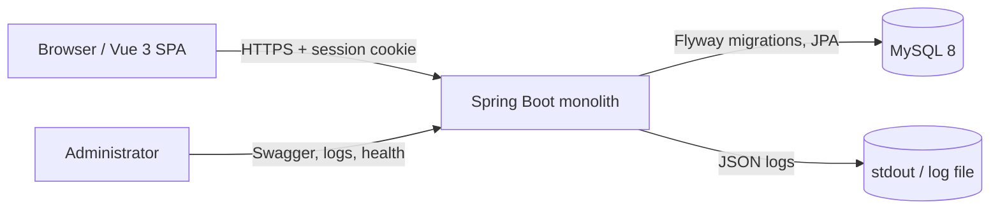
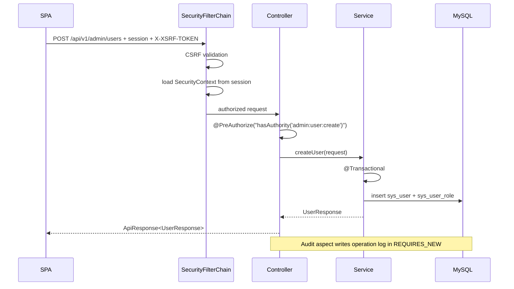
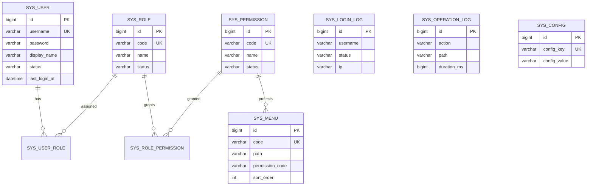

# Architecture

This document describes the current MXXSSM architecture, the main design decisions,
and how to extend the monolith safely.

## 1. Goals

The rewrite had four goals:

1. Replace the XML-configured SSM/JSP stack with a conventional modern stack.
2. Keep the deployment simple: one repository, one build, one executable.
3. Make authorization and auditing explicit rather than interceptor side effects.
4. Leave a codebase that is easy to extend module by module.

## 2. System context



In development the browser talks to Vite on `:5173`, which proxies `/api` to the
backend on `:8081`. In production the SPA is copied into the jar and served by the
backend on a single origin.

## 3. Backend structure

```text
com.mxxssm
├── MxxSsmApplication
├── common
│   ├── api          ApiResponse, PageResult, ErrorCode
│   ├── audit        @AuditLog + AOP aspect
│   ├── domain       status constants
│   ├── exception    BusinessException + GlobalExceptionHandler
│   ├── security     SecurityConfig, UserDetails, CSRF, JSON 401/403 handlers
│   └── web          request id, SPA fallback, pagination, client IP
├── config           AppProperties, OpenAPI, MVC
└── modules
    ├── auth         login/logout/captcha/register/profile/password
    ├── user         SysUser + repository + service + controller + DTOs
    ├── role         roles and role-permission assignment
    ├── permission   permission definitions
    ├── menu         sidebar entries
    ├── config       runtime key/value configuration
    ├── log          login and operation audit records
    ├── dashboard    aggregate metrics
    └── publicapi    unauthenticated site settings
```

The package layout is **feature-first** for application modules and **layer-first**
inside the small `common` package. A feature module owns its entity, repository,
service, controller and DTOs.

Dependency direction:

```text
Controller → Service → Repository → Database
                 ↘ common (errors, security utilities, audit)
```

ArchUnit enforces that controllers do not depend on repositories, services do not
depend on controllers, and repositories do not depend on services.

## 4. Request lifecycle



### Security chain

- `SecurityFilterChain` is stateless only in the sense that it does not create a
  session per request; it uses `IF_REQUIRED` and persists the `SecurityContext`
  in the HTTP session.
- Public endpoints are limited to login, register, captcha, CSRF bootstrap, public
  site settings, health, and OpenAPI in development.
- All other `/api/**` routes require authentication.
- Authorization is method-level with permission codes.
- `JsonAuthenticationEntryPoint` and `JsonAccessDeniedHandler` return the same
  envelope as the rest of the API instead of HTML error pages.
- `SpaWebFilter` forwards non-API, non-asset GET requests with `Accept: text/html`
  to `/index.html`, enabling Vue Router history mode.

### CSRF

The SPA cannot read the default XOR-masked token from a cookie, so the project
uses a small `SpaCsrfTokenRequestHandler`:

- header values are compared against the raw cookie token;
- form values continue to use the XOR handler;
- `CsrfCookieFilter` forces the deferred token to be written to the `XSRF-TOKEN`
  cookie before the SPA's first unsafe request.

Axios is configured with `xsrfCookieName` and `xsrfHeaderName`, and the HTTP layer
retries once after refreshing an expired token.

## 5. Data model



Notes:

- `sys_menu.permission_code` is intentionally a code reference, not a foreign key.
  This keeps menus portable and lets permissions be recreated without cascading
  menu deletes. The service validates that the permission exists.
- Status values are strings (`ACTIVE`/`DISABLED`) for portability and readable SQL.
- `created_at`/`updated_at` are managed by Hibernate (`@CreationTimestamp`,
  `@UpdateTimestamp`) with database defaults for rows inserted outside the app.

## 6. RBAC flow

1. `CustomUserDetailsService` loads the user with roles and permissions in one
   transaction.
2. Each active role contributes `ROLE_<CODE>`; each active permission contributes
   its code as a `GrantedAuthority`.
3. The login response includes:
   - role codes,
   - flat permission codes,
   - menus whose `permission_code` is in the permission set.
4. The Vue router guard checks `meta.permission` against the auth store.
5. The backend independently enforces the same permission via `@PreAuthorize`.

The frontend check is a UX filter; the backend check is the security boundary. Global
dashboard metrics additionally require `admin:dashboard:read`, so standard users get a personal
shortcut panel instead of administration statistics.

## 7. Audit flow

- Login logs are written directly by `AuthService` for captcha failures, disabled
  accounts, bad credentials and success.
- Operation logs are written by `AuditLogAspect` around methods annotated with
  `@AuditLog(action = "...")`.
- `LogService.recordOperation` uses `Propagation.REQUIRES_NEW`, so a rollback of the
  business transaction does not remove the audit row.
- Duration is measured in nanoseconds and stored in milliseconds.
- Passwords and request bodies are never stored.

## 8. Frontend architecture

```text
src/
├── api/           typed API modules + Axios instance + CSRF retry
├── components/    reusable UI (logo, icon, status tag, page header, stat card)
├── composables/   responsive breakpoint
├── layouts/       AuthLayout (split-screen) and AppLayout (sidebar + header)
├── locales/       zh-CN / en-US dictionaries + vue-i18n setup
├── router/        routes, meta.permission guard, titles
├── stores/        auth (user, permissions, menus) and app (locale, theme, sidebar)
├── styles/        design tokens, dark theme, shared page/table styles
├── types/         shared TypeScript models
├── utils/         access, navigation grouping, formatting
└── views/         login, register, dashboard, system pages, profile, settings
```

- `main.ts` loads public settings, primes the CSRF cookie, restores the session
  (`GET /auth/me`) and only then mounts the router.
- The router guard waits for session restoration before deciding to redirect.
- `AppLayout` builds the sidebar from `auth.menus`, grouped by `groupName` and
  localized by menu code.
- Element Plus locale and the i18n locale are driven by the same Pinia store.
- Dark mode toggles the `dark` class on `<html>` and applies Element Plus dark
  variables.
- Dialogs use `append-to-body` so fixed overlays are not clipped by transformed
  page containers.

## 9. Configuration and secrets

- Local defaults live in `application-dev.yml`.
- Production configuration comes from environment variables in
  `application-prod.yml`.
- Do not commit real secrets. `.env` is ignored; `.env.example` contains
  placeholders.
- `springdoc` is disabled by default in production.

## 10. Trade-offs

### Session instead of JWT

The application is a same-origin monolith. Session cookies plus CSRF are simpler
to secure than storing JWTs in browser storage, and logout/session invalidation is
immediate. If the API needs to serve multiple clients, add a token endpoint with a
short-lived access token and refresh rotation.

### JPA instead of MyBatis

The schema is small and relationship-heavy. JPA removes the mapper XML and gives
entities, transactions and pagination for free. Reporting queries should be added
as explicit JPQL/native queries or projections rather than leaking entities into
controllers.

### Permission staleness

Authorities are loaded at login. Changing a role does not update existing sessions.
This is acceptable for an internal admin tool and keeps the request path cheap.
For immediate revocation, add a permission version to the session and compare it
against a cached value, or query authorities per request with a short-lived cache.

### Single jar

The frontend build is part of the release. This keeps deployment trivial, at the
cost of a larger artifact and a slower full build. For independent frontend
deployments, remove the `with-frontend` Maven profile and serve `frontend/dist`
from a CDN.

## 11. Extending the system

Adding a feature module:

1. Create `modules/<feature>` with entity, repository, service, controller and DTOs.
2. Add a Flyway migration (`V3__...sql`); never edit applied migrations.
3. Add permission codes in a migration and assign them to `ADMIN`.
4. Add a menu row with the permission code.
5. Protect controller methods with `@PreAuthorize`.
6. Add `@AuditLog` to mutating operations.
7. Add an API module and view on the frontend; add `meta.permission` to the route.
8. Add integration tests using the existing `AuthFlowIntegrationTest` pattern.
